# 🏆 Gold Layer KPIs Documentation

> **Comprehensive Key Performance Indicators** from Silver Layer tables in the `punit_dbx` database. Each KPI is materialized as a Gold Layer table supporting critical business insights across customer behavior, product performance, and operational efficiency.

---

## 📊 Table of Contents

| KPI | Description | Focus Area |
|-----|-------------|------------|
| [1. Customer Return Rate](#1-customer-return-rate) | Customer retention and churn analysis | 👥 Customer Behavior |
| [2. Product Return Rate by Brand](#2-product-return-rate-by-brand) | Brand-specific return performance | 📦 Product Performance |
| [3. Average Product Rating by Category](#3-average-product-rating-by-category) | Category-wise product satisfaction | ⭐ Quality Metrics |
| [4. Payment Method Preference](#4-payment-method-preference) | Transaction payment patterns | 💳 Payment Analytics |
| [5. Peak Purchase Activity](#5-peak-purchase-activity) | High-activity time periods | 🗓️ Temporal Analysis |
| [6. Average Delivery Time](#6-average-delivery-time) | Shipping method performance | 🚚 Logistics Efficiency |
| [7. Repeat Product Purchases](#7-repeat-product-purchases) | Customer loyalty patterns | 🔁 Loyalty Analysis |
| [8. Revenue Risk Assessment](#8-revenue-risk-assessment) | Return-based revenue impact | 💸 Financial Risk |
| [9. Purchase Frequency by Timeslot](#9-purchase-frequency-by-timeslot) | Shopping behavior patterns | ⏰ Behavioral Insights |
| [10. Demographics Revenue Analysis](#10-demographics-revenue-analysis) | Age and gender-based insights | 🧑‍🤝‍🧑 Demographics |
| [11. Product Loyalty Score](#11-product-loyalty-score) | Product-specific repeat purchases | 🔁 Product Loyalty |
| [12. Brand Loyalty Score](#12-brand-loyalty-score) | Brand-specific customer loyalty | 💎 Brand Loyalty |

---

## 1. 📈 Customer Return Rate

### 🔁 Q1: Customer Retention Rate (Returning Customers)

**📋 Overview:** Measures the percentage of customers who return and make repeat purchases within a year.

**📊 Output Schema:**
- `Year` - Calendar year
- `Percentage` - Retention rate percentage

```sql
-- Temporary View for Repeated Customers
CREATE OR REPLACE TEMPORARY VIEW repeated_cust AS (
  WITH cte AS (
    SELECT DISTINCT customer_id, dd.year
    FROM punit_dbx.silver.fact_orders_details fos
    JOIN punit_dbx.silver.dim_date dd ON fos.date_id = dd.date_id
  ),
  cte2 AS (
    SELECT *,
           LAG(year) OVER(PARTITION BY customer_id ORDER BY year) AS lag_year
    FROM cte
  )
  SELECT * FROM cte2 WHERE year = lag_year + 1
);

-- Temporary View for All Customers
CREATE OR REPLACE TEMPORARY VIEW all_cust AS (
  SELECT DISTINCT customer_id, dd.year
  FROM punit_dbx.silver.fact_orders_details fos
  JOIN punit_dbx.silver.dim_date dd ON fos.date_id = dd.date_id
);

-- Final Output Table
CREATE OR REPLACE TABLE punit_dbx.gold.cust_return_rate AS (
  WITH cte_cnt_repeated AS (
    SELECT year, COUNT(*) AS repeated_cnt FROM repeated_cust GROUP BY year
  ),
  cte_cnt_all AS (
    SELECT year, COUNT(*) AS all_cnt FROM all_cust GROUP BY year
  )
  SELECT cca.year,
         ROUND((100 * ccr.repeated_cnt) / cca.all_cnt, 2) AS repeated_percentage
  FROM cte_cnt_repeated ccr
  RIGHT JOIN cte_cnt_all cca ON ccr.year = cca.year
  ORDER BY year
);
```

📊 **Result**:
<p align="center">
  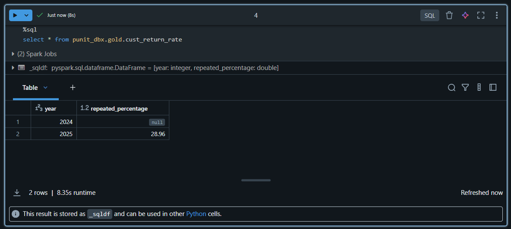
</p>


### 📉 Q2: Monthly Churn Rate (Customers Who Didn't Come Back)

**📋 Overview:** Percentage of customers who purchased in the previous month but did not return in the current month.

**📊 Output Schema:**
- `Month` - Calendar month
- `Percentage` - Churn rate percentage

```sql
-- Monthly Repeated Customers View
CREATE OR REPLACE TEMPORARY VIEW repeated_cust AS (
  WITH cte AS (
    SELECT DISTINCT customer_id, dd.year, dd.month
    FROM punit_dbx.silver.fact_orders_details fos
    JOIN punit_dbx.silver.dim_date dd ON fos.date_id = dd.date_id
  ),
  cte2 AS (
    SELECT *,
           LAG(year) OVER(PARTITION BY customer_id ORDER BY year, month) AS lag_year,
           LAG(month) OVER(PARTITION BY customer_id ORDER BY year, month) AS lag_month
    FROM cte
  )
  SELECT * FROM cte2 
  WHERE (year = lag_year AND month = lag_month + 1)
     OR (year = lag_year + 1 AND lag_month = 12 AND month = 1)
);

-- Final Monthly Churn Table
CREATE OR REPLACE TABLE punit_dbx.gold.monthly_churn_rate AS (
  WITH cte_cnt_repeated AS (
    SELECT year, month, COUNT(*) AS repeated_cnt FROM repeated_cust GROUP BY year, month
  ),
  cte_cnt_all AS (
    SELECT year, month, COUNT(*) AS all_cnt FROM all_cust GROUP BY year, month
  ),
  result_cte AS (
    SELECT cca.year, cca.month,
           ROUND((100 * ccr.repeated_cnt) / cca.all_cnt, 2) AS repeated_percentage
    FROM cte_cnt_repeated ccr
    RIGHT JOIN cte_cnt_all cca ON ccr.year = cca.year AND ccr.month = cca.month
  )
  SELECT year, month, repeated_percentage, 
         ROUND((100 - repeated_percentage), 2) AS not_repeated
  FROM result_cte
);
```

📊 **Result**:
<p align="center">
  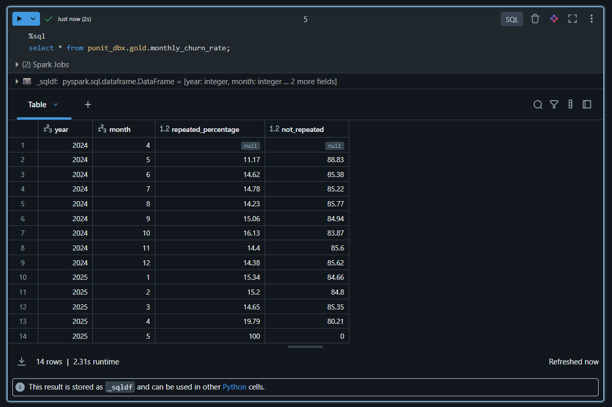
</p>

---

## 2. 📦 Product Return Rate by Brand

**📋 Overview:** Percentage of products returned or cancelled per brand, relative to total confirmed orders.

**📊 Output Schema:**
- `Product Brand` - Brand name
- `Return Rate (%)` - Return/cancellation rate

```sql
CREATE OR REPLACE TABLE punit_dbx.gold.order_return_rate AS (
  WITH cte AS (
    SELECT product_brand_id,
           SUM(CASE WHEN LOWER(ods.order_status) IN ('cancelled', 'returned') THEN 1 ELSE 0 END) AS return_cnt,
           SUM(CASE WHEN LOWER(ods.order_status) = 'order' THEN 1 ELSE 0 END) AS final_sts_cnt
    FROM punit_dbx.silver.fact_orders_details fos
    JOIN dim_order_status ods ON fos.order_status_id = ods.order_status_id
    GROUP BY product_brand_id
  )
  SELECT dpb.product_brand,
         ROUND((return_cnt * 100.0 / final_sts_cnt), 2) AS return_rate
  FROM cte
  JOIN punit_dbx.silver.dim_product_brand dpb ON cte.product_brand_id = dpb.product_brand_id
);
```

📊 **Result**:
<p align="center">
  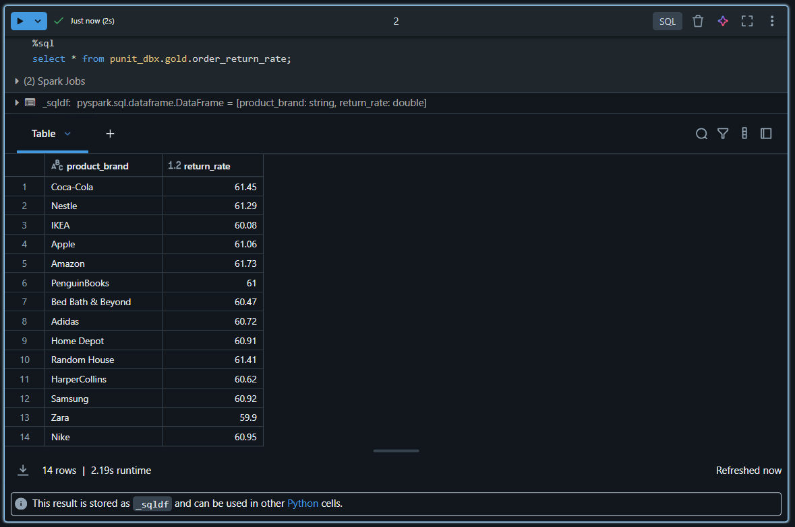
</p>

---

## 3. ⭐ Average Product Rating by Category

**📋 Overview:** Computes the average rating of products grouped by their category.

**📊 Output Schema:**
- `Product Category` - Category name
- `Average Rating` - Mean rating score

```sql
CREATE OR REPLACE TABLE punit_dbx.gold.avg_rating_prod_category AS (
  WITH cte AS (
    SELECT DISTINCT fos.transaction_id, fos.product_category_id, fos.product_id,
           COALESCE(fd.rating, 0) AS rating
    FROM punit_dbx.silver.fact_orders_details fos
    JOIN punit_dbx.silver.dim_feedback fd ON fos.feedback_id = fd.feedback_id
  ),
  cte2 AS (
    SELECT product_category_id, ROUND(AVG(rating), 3) AS avg_rate
    FROM cte
    GROUP BY product_category_id
  )
  SELECT dpc.product_category, avg_rate
  FROM cte2
  JOIN punit_dbx.silver.dim_product_category dpc ON cte2.product_category_id = dpc.product_category_id
);
```

📊 **Result**:
<p align="center">
  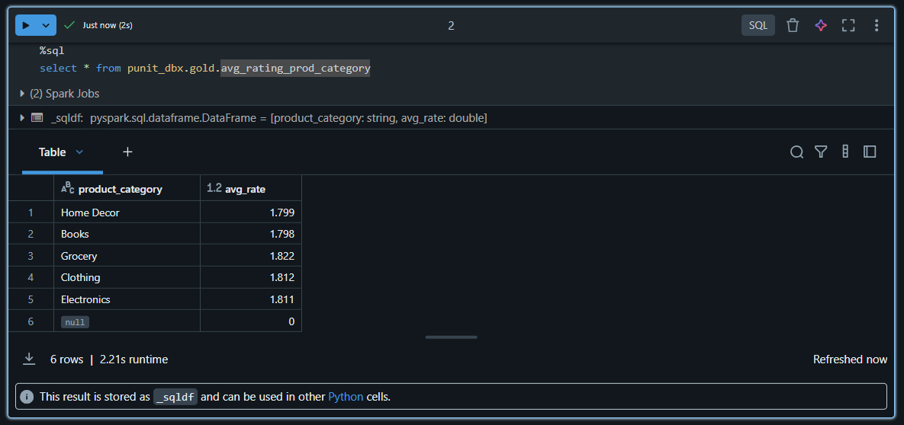
</p>


---

## 4. 💳 Payment Method Preference

**📋 Overview:** Most frequently used payment methods, expressed as a percentage of all transactions.

**📊 Output Schema:**
- `Payment Method` - Payment type
- `Usage Frequency (%)` - Usage percentage

```sql
CREATE OR REPLACE TABLE punit_dbx.gold.pay_method_freq AS (
  WITH cte AS (
    SELECT DISTINCT transaction_id, payment_method_id
    FROM punit_dbx.silver.fact_orders_details
  ),
  cte2 AS (
    SELECT payment_method_id, COUNT(*) AS cnt
    FROM cte GROUP BY payment_method_id
  ),
  cte3 AS (
    SELECT COUNT(DISTINCT transaction_id) AS cnt FROM punit_dbx.silver.fact_orders_details
  )
  SELECT cte2.payment_method_id, dpm.payment_method,
         ROUND(cnt * 100.0 / (SELECT cnt FROM cte3), 2) AS avg_rate
  FROM cte2
  JOIN punit_dbx.silver.dim_payment_method dpm ON cte2.payment_method_id = dpm.payment_method_id
);
```

📊 **Result**:

<p align="center">
  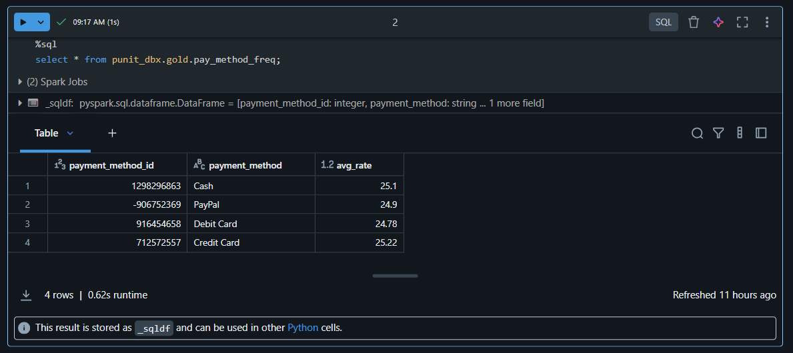
</p>


---

## 5. 🗓️ Peak Purchase Activity

**📋 Overview:** Highlights high-activity dates by analyzing order frequency across time periods.

**📊 Output Schema:**
- `Day` - Day of month
- `Weekday` - Day name
- `Month` - Calendar month
- `Year` - Calendar year
- `Product Count` - Total products sold

```sql
CREATE OR REPLACE TABLE punit_dbx.gold.most_product_purchase AS (
  WITH cte AS (
    SELECT DATE(fos.datetimestamp) AS date_,
           SUM(COALESCE(FLOOR(quantity), 1)) AS total_product
    FROM punit_dbx.silver.fact_orders_details fos
    JOIN punit_dbx.silver.dim_order_status dos 
      ON fos.order_status_id = dos.order_status_id 
     AND LOWER(dos.order_status) = 'order'
    GROUP BY DATE(fos.datetimestamp)
    ORDER BY total_product DESC
    LIMIT 1
  )
  SELECT DAY(date_) AS day_num,
         DATE_FORMAT(date_, 'EEEE') AS day_name,
         MONTH(date_) AS month,
         YEAR(date_) AS year,
         total_product
  FROM cte
);
```

📊 **Result**:
<p align="center">
  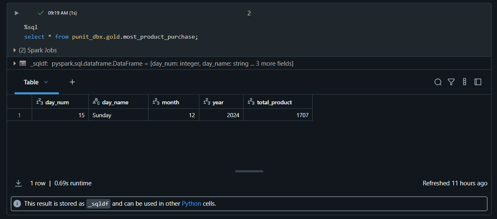
</p>

---

## 6. 🚚 Average Delivery Time by Shipping Method

**📋 Overview:** Calculates average delivery days by shipping method across each year and month.

**📊 Output Schema:**
- `Year` - Calendar year
- `Month` - Calendar month
- `Shipping Method` - Delivery method
- `Avg Delivery Time (days)` - Average delivery duration

```sql
CREATE OR REPLACE TABLE punit_dbx.gold.avg_ship_time AS (
  WITH order_cte AS (
    SELECT transaction_id, customer_id, shipping_method_id,
           CASE WHEN LOWER(dos.order_status) = 'order' THEN datetimestamp END AS order_time
    FROM punit_dbx.silver.fact_orders_details fos
    JOIN punit_dbx.silver.dim_order_status dos ON fos.order_status_id = dos.order_status_id
  ),
  deliver_cte AS (
    SELECT transaction_id, customer_id, shipping_method_id,
           CASE WHEN LOWER(dos.order_status) = 'delivered' THEN datetimestamp END AS deliver_time
    FROM punit_dbx.silver.fact_orders_details fos
    JOIN punit_dbx.silver.dim_order_status dos ON fos.order_status_id = dos.order_status_id
  ),
  cte3 AS (
    SELECT oc.*, DATEDIFF(dc.deliver_time, oc.order_time) AS date_dif
    FROM order_cte oc
    JOIN deliver_cte dc ON oc.transaction_id = dc.transaction_id
    WHERE order_time IS NOT NULL AND deliver_time IS NOT NULL
  ),
  cte4 AS (
    SELECT MONTH(order_time) AS month_num,
           DATE_FORMAT(order_time, 'MMMM') AS month,
           YEAR(order_time) AS year,
           shipping_method_id,
           ROUND(AVG(date_dif), 2) AS avg_days
    FROM cte3
    GROUP BY month_num, month, year, shipping_method_id
  )
  SELECT a.month, a.year, ds.shipping_method, a.avg_days
  FROM cte4 a
  JOIN punit_dbx.silver.dim_shipping ds ON a.shipping_method_id = ds.shipping_method_id
  ORDER BY year, month_num, avg_days
);
```

📊 **Result**:
<p align="center">
  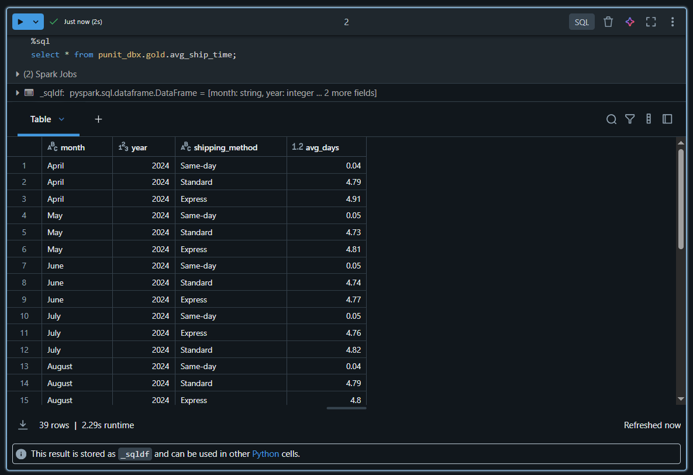
</p>

---

## 7. 🔁 Repeat Product Purchases by Customers

**📋 Overview:** Identifies customers who bought the same product multiple times.

**📊 Output Schema:**
- `Customer ID` - Unique customer identifier
- `Product Name` - Product name
- `Number of Purchases` - Purchase count

```sql
CREATE OR REPLACE TABLE punit_dbx.gold.repeated_purchase_cust AS (
  WITH cte AS (
    SELECT DISTINCT product_id, customer_id, transaction_id
    FROM punit_dbx.silver.fact_orders_details
  ),
  cte2 AS (
    SELECT customer_id, product_id, COUNT(*) AS orders
    FROM cte GROUP BY product_id, customer_id
    HAVING COUNT(*) > 1
  )
  SELECT DISTINCT cte2.customer_id, dp.product_name, cte2.orders
  FROM cte2
  JOIN punit_dbx.silver.dim_product dp ON cte2.product_id = dp.product_id
);
```
📊 **Result**:
<p align="center">
  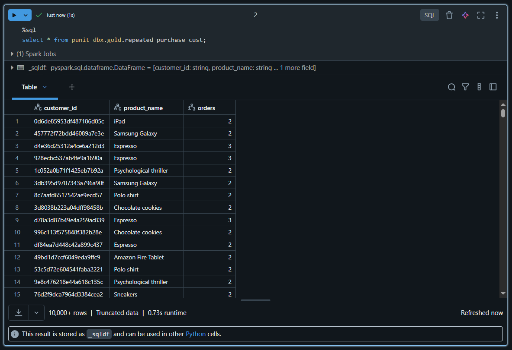
</p>
<p align="center">
  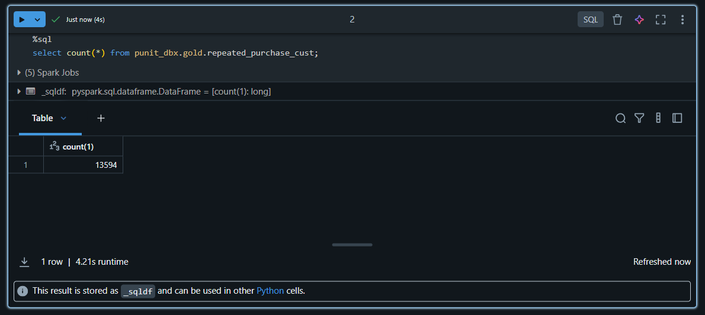
</p>


---

## 8. 🔻 Revenue Risk Assessment

**📋 Overview:** Identifies how much revenue is lost due to returned products by location.

**📊 Output Schema:**
- `Country` - Country name
- `State` - State/region name
- `Total Revenue` - Total revenue generated
- `Revenue Lost` - Revenue lost to returns
- `Revenue Risk Percentage` - Risk percentage

```sql
CREATE OR REPLACE TABLE punit_dbx.gold.risk_revanue_rate AS (
  WITH cte AS (
    SELECT fos.*,
           dp.amount,
           CASE WHEN fos.quantity IS NOT NULL THEN FLOOR(fos.quantity) ELSE 1 END AS quantity_,
           dos.order_status 
    FROM punit_dbx.silver.fact_orders_details AS fos
    JOIN punit_dbx.silver.dim_product AS dp ON fos.product_id = dp.product_id
    JOIN punit_dbx.silver.dim_order_status AS dos ON fos.order_status_id = dos.order_status_id
      AND LOWER(dos.order_status) IN ('returned', 'delivered')
  ),
  cte2 AS (
    SELECT dl.state_id,
           dl.country_id,
           SUM(CASE WHEN LOWER(c.order_status) = 'delivered' THEN amount * quantity_ ELSE 0 END) AS total_price,
           SUM(CASE WHEN LOWER(c.order_status) = 'returned' THEN amount * quantity_ ELSE 0 END) AS return_price 
    FROM cte AS c
    JOIN punit_dbx.silver.dim_location AS dl ON dl.location_id = c.location_id
    GROUP BY dl.state_id, dl.country_id
  )
  SELECT ds.state,
         dc.country,
         total_price AS Total_revenue,
         return_price AS revenue_lost,
         ROUND((100 * return_price) / (total_price + return_price), 2) AS revenue_risk_percentage 
  FROM cte2 AS c
  JOIN punit_dbx.silver.dim_country AS dc ON dc.country_id = c.country_id
  JOIN punit_dbx.silver.dim_state AS ds ON c.state_id = ds.state_id
);
```
**🖼️ Result:**

<p align="center">
  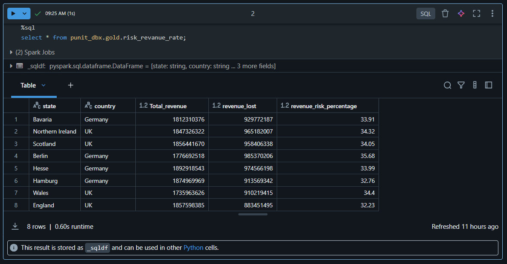
</p>

---

## 9. ⏰ Purchase Frequency by Timeslot

**📋 Overview:** Shows frequency of product purchases in 6-hour slots to understand peak shopping hours.

**🕐 Timeslot Breakdown:**
- 🌙 **12 AM - 6 AM** - Late night/early morning
- 🌅 **6 AM - 12 PM** - Morning hours
- 🌤️ **12 PM - 6 PM** - Afternoon hours
- 🌆 **6 PM - 12 AM** - Evening hours

**📊 Output Schema:**
- `TimeSlot` - Time period
- `Frequency` - Purchase count

```sql
CREATE OR REPLACE TABLE punit_dbx.gold.mst_prdct_prchs_freq_timeslot AS (
  WITH cte AS (
    SELECT DISTINCT
           transaction_id,
           product_id,
           CASE 
             WHEN HOUR(datetimestamp) BETWEEN 0 AND 6 THEN "12 AM - 6 AM"
             WHEN HOUR(datetimestamp) BETWEEN 6 AND 12 THEN "6 AM - 12 PM"
             WHEN HOUR(datetimestamp) BETWEEN 12 AND 18 THEN "12 PM - 6 PM"
             WHEN HOUR(datetimestamp) BETWEEN 18 AND 23 THEN "6 PM - 12 AM"
             ELSE NULL
           END AS timeslot
    FROM punit_dbx.silver.fact_orders_details
    WHERE datetimestamp IS NOT NULL
  )
  SELECT timeslot AS TimeSlot,
         COUNT(*) AS Frequency 
  FROM cte
  GROUP BY timeslot
);
```
**🖼️ Result:**

<p align="center">
  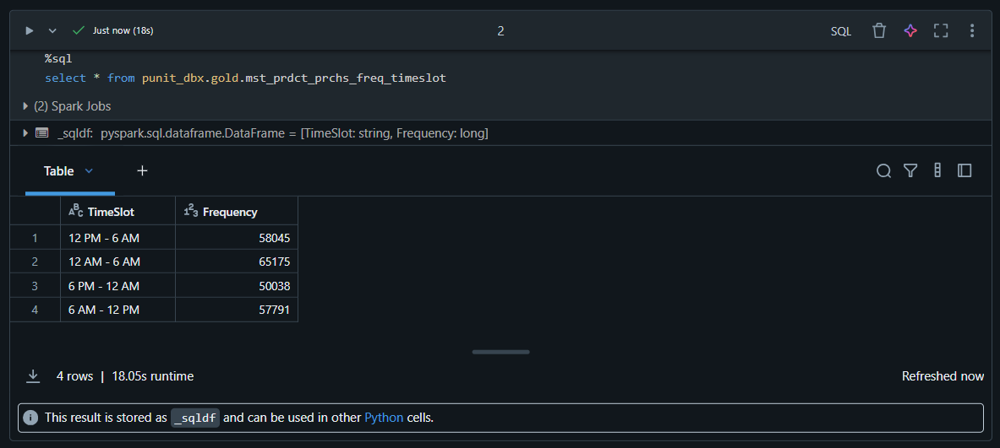
</p>


---

## 10. 🧑‍🤝‍🧑 Demographics Revenue Analysis

**📋 Overview:** Shows revenue contribution by product types, split across genders and various age groups.

**📊 Output Schema:**
- `Product Name` - Product identifier
- `Gender` - Customer gender
- `Age Group` - Age category
- `Total Revenue` - Revenue generated
- `Average Rating` - Average product rating

```sql
-- Create Fact View
CREATE OR REPLACE TEMPORARY VIEW fact_vw AS (
  SELECT a.transaction_id,
         a.product_id,
         a.datetimestamp,
         a.birth_date,
         b.order_status,
         dc.customer_id,
         dc.gender,
         dp.product_name,
         dp.amount,
         CASE WHEN quantity IS NOT NULL THEN FLOOR(quantity) ELSE 1 END AS quantity_,
         CASE 
           WHEN FLOOR(DATEDIFF(CURRENT_DATE(), TO_DATE(a.birth_date, 'dd/MM/yyyy')) / 365) BETWEEN 0 AND 12 THEN '0 - 12'
           WHEN FLOOR(DATEDIFF(CURRENT_DATE(), TO_DATE(a.birth_date, 'dd/MM/yyyy')) / 365) BETWEEN 12 AND 20 THEN '12 - 20'
           WHEN FLOOR(DATEDIFF(CURRENT_DATE(), TO_DATE(a.birth_date, 'dd/MM/yyyy')) / 365) BETWEEN 20 AND 35 THEN '20 - 35'
           WHEN FLOOR(DATEDIFF(CURRENT_DATE(), TO_DATE(a.birth_date, 'dd/MM/yyyy')) / 365) BETWEEN 35 AND 50 THEN '35 - 50'
           WHEN FLOOR(DATEDIFF(CURRENT_DATE(), TO_DATE(a.birth_date, 'dd/MM/yyyy')) / 365) > 50 THEN '50 and Above'
           ELSE NULL
         END AS age_grp
  FROM punit_dbx.silver.fact_orders_details AS a
  INNER JOIN punit_dbx.silver.dim_order_status AS b
    ON a.order_status_id = b.order_status_id AND b.order_status = 'Order'
  INNER JOIN punit_dbx.silver.dim_customer AS dc
    ON a.customer_id = dc.customer_id
  INNER JOIN punit_dbx.silver.dim_product AS dp
    ON a.product_id = dp.product_id
    AND a.datetimestamp BETWEEN dp.start_date AND dp.end_date
);

-- Final Demographics Revenue Table
CREATE OR REPLACE TABLE punit_dbx.gold.age_grp_revenue AS (
  WITH cte AS (
    SELECT DISTINCT *
    FROM fact_vw AS t
    LEFT ANTI JOIN (
      SELECT DISTINCT transaction_id, product_id 
      FROM punit_dbx.silver.fact_orders_details AS a 
      INNER JOIN punit_dbx.silver.dim_order_status AS b
        ON a.order_status_id = b.order_status_id 
      WHERE b.order_status IN ('Returned', 'Cancelled')
    ) AS r
    ON t.transaction_id = r.transaction_id AND t.product_id = r.product_id
  ),
  cte2 AS (
    SELECT *,
           (fos.quantity_ * fos.amount) AS t_price,
           CASE WHEN df.rating IS NOT NULL THEN df.rating ELSE 0 END AS rating_
    FROM cte AS fos
    INNER JOIN punit_dbx.silver.dim_feedback AS df
      ON df.customer_id = fos.customer_id
      AND df.product_id = fos.product_id
      AND fos.datetimestamp BETWEEN df.start_date AND df.end_date
  )
  SELECT product_name, 
         Gender, 
         age_grp AS age_group,
         ROUND(SUM(t_price), 3) AS total_revenue, 
         ROUND(AVG(rating_), 3) AS avg_ratings
  FROM cte2
  GROUP BY product_name, Gender, age_grp
  ORDER BY age_group, total_revenue
);
```
**🖼️ Result:**

<p align="center">
  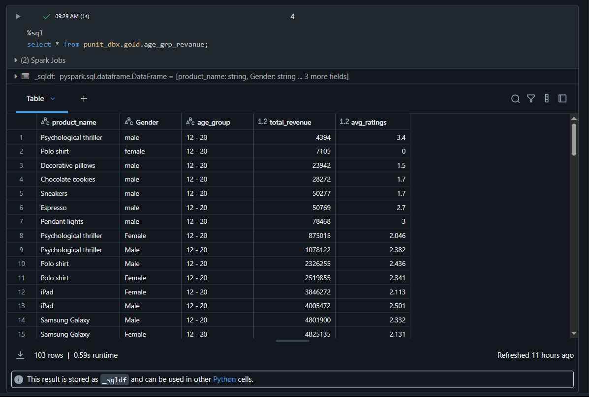<br>
  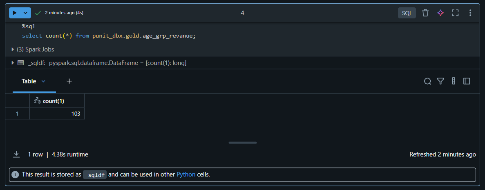
</p>

---

## 11. 🔁 Product Loyalty Score

**📋 Overview:** Highlights products with high loyalty — where the same customer buys the same product more than once.

**📊 Output Schema:**
- `Product Name` - Product identifier
- `Product Brand` - Brand name
- `Repeat Purchase Count` - Total repeat purchases
- `Repeat Customers` - Number of repeat customers
- `Repeat Purchase %` - Percentage of repeat purchases

```sql
CREATE OR REPLACE TABLE punit_dbx.gold.rept_prchs_score_prdct AS (
  WITH cte AS (
    SELECT customer_id,
           product_id,
           product_brand_id,
           COUNT(*) AS buy_count,
           COUNT(*) AS repeat_customer
    FROM punit_dbx.silver.fact_orders_details
    GROUP BY customer_id, product_id, product_brand_id
  ),
  repeat_cte AS (
    SELECT product_id, 
           product_brand_id,
           SUM(buy_count) AS repeated_count,
           COUNT(DISTINCT customer_id) AS cust_repeated
    FROM cte
    WHERE buy_count > 1
    GROUP BY product_id, product_brand_id
  ),
  all_cte AS (
    SELECT product_id, 
           product_brand_id,
           SUM(buy_count) AS all_buy_count
    FROM cte
    GROUP BY product_id, product_brand_id
  ),
  result_cte AS (
    SELECT r.*,
           ROUND((r.repeated_count * 100) / a.all_buy_count, 2) AS Repeat_Purchase_Percentage
    FROM repeat_cte AS r
    JOIN all_cte AS a
      ON r.product_id = a.product_id
      AND r.product_brand_id = a.product_brand_id
  )
  SELECT DISTINCT
         dp.product_name,
         dpb.product_brand,
         rc.repeated_count,
         rc.cust_repeated,
         rc.Repeat_Purchase_Percentage
  FROM result_cte AS rc
  JOIN punit_dbx.silver.dim_product AS dp ON rc.product_id = dp.product_id
  JOIN punit_dbx.silver.dim_product_brand AS dpb ON dpb.product_brand_id = rc.product_brand_id
);
```

**🖼️ Result:**

<p align="center">
  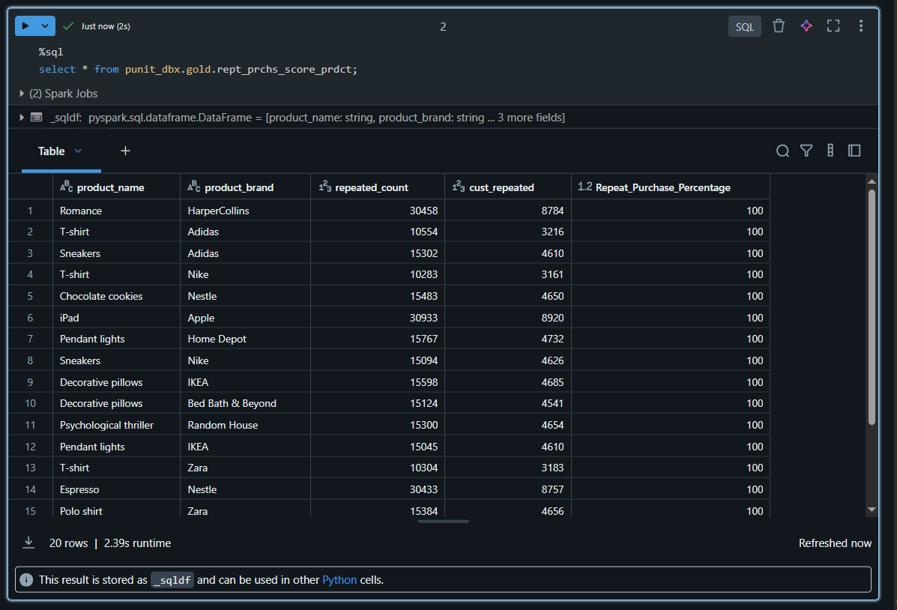<br>
  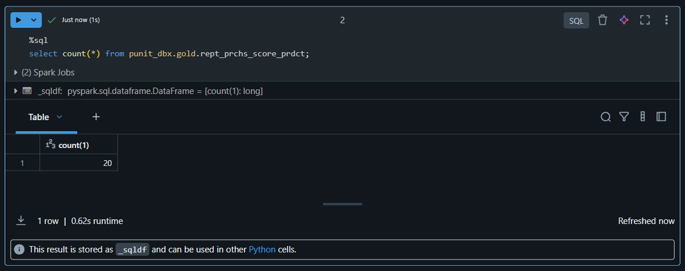
</p>

---

## 12. 💎 Brand Loyalty Score

**📋 Overview:** Evaluates how loyal customers are to specific brands by calculating repeat purchases.

**📊 Output Schema:**
- `Brand` - Brand name
- `Customer ID` - Customer identifier
- `Repeat Purchase Count` - Number of repeat purchases
- `Last Purchase Date` - Most recent purchase
- `Average Rating` - Average rating given by customer

```sql
CREATE OR REPLACE TABLE punit_dbx.gold.brnd_loyalty_scr AS (
  WITH cte AS (
    SELECT fos.customer_id, 
           fos.product_brand_id,
           COUNT(*) AS Repeated_Purchase_Count,
           MAX(datetimestamp) AS Last_Purchase_Date,
           ROUND(AVG(CASE WHEN df.rating IS NULL THEN 0 ELSE df.rating END), 2) AS avg_rate
    FROM punit_dbx.silver.fact_orders_details AS fos
    JOIN dim_order_status AS dos
      ON fos.order_status_id = dos.order_status_id
      AND LOWER(dos.order_status) = 'order'
    JOIN punit_dbx.silver.dim_feedback AS df 
      ON fos.feedback_id = df.feedback_id
      AND fos.datetimestamp BETWEEN df.start_date AND df.end_date
    GROUP BY fos.customer_id, fos.product_brand_id
  )
  SELECT dpb.product_brand,
         c.customer_id,
         c.Repeated_Purchase_Count,
         c.Last_Purchase_Date,
         c.avg_rate
  FROM cte AS c
  JOIN punit_dbx.silver.dim_product_brand AS dpb
    ON c.product_brand_id = dpb.product_brand_id
  WHERE c.Repeated_Purchase_Count > 1
);
```

**🖼️ Result:**

<p align="center">
  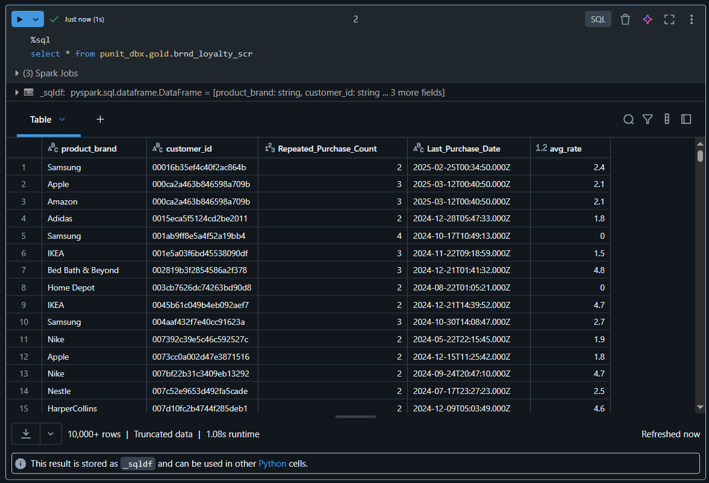<br>
  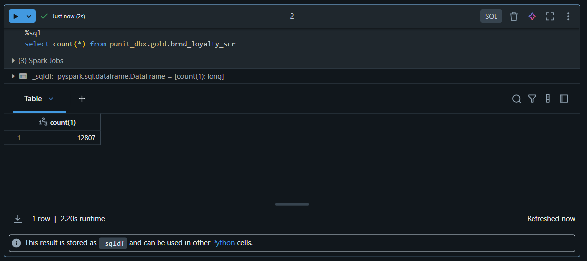
</p>

---